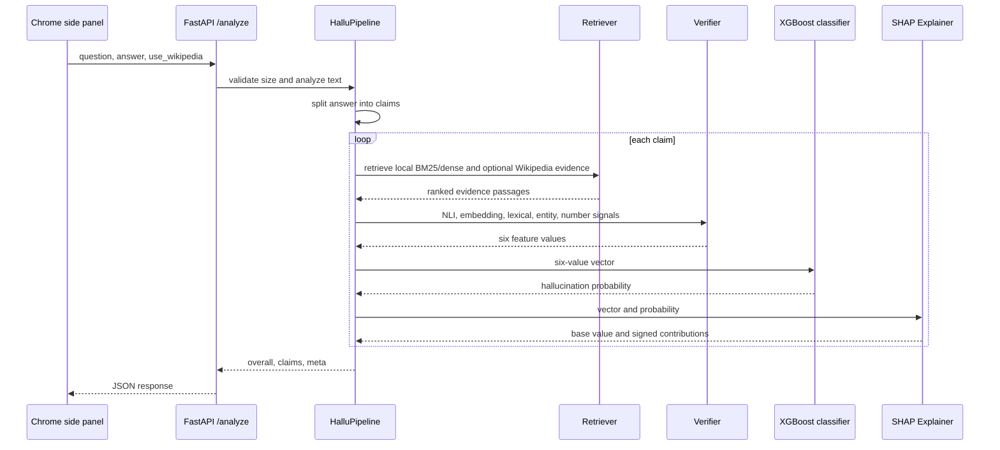

# Hallucination XAI backend API guide

This guide describes the FastAPI backend as it runs in the student project. The examples below
were captured from the local server on 2026-10-22 using the sample knowledge base and the current
synthetic placeholder classifier. A real-data model is required before treating the scores as
evaluation results.

## Endpoints

### `GET /health`

Returns a short readiness snapshot:

```json
{
  "status": "ok",
  "classifier": "synthetic-placeholder",
  "kb_passages": 10,
  "nli_loaded": false,
  "embedding_loaded": false
}
```

`classifier` identifies the loaded model source, `kb_passages` counts local passages, and the two
model flags show whether NLI and sentence embeddings have been loaded in this process.

### `POST /analyze`

Request JSON:

| Field | Type | Required | Meaning |
|---|---|---:|---|
| `question` | string | no | The question associated with the answer; defaults to `""`. It helps retrieve evidence when a claim uses pronouns. |
| `answer` | string | yes | Text to split and check. Blank text returns `422`; text over 8,000 characters returns `413`. |
| `use_wikipedia` | boolean or `null` | no | Overrides the configured Wikipedia lookup for this request. `false` makes the request local-only. |

The response keeps the extension contract: `overall`, `claims`, and `meta` remain top-level keys.
New metadata may be added without changing the existing claim fields.

Captured response excerpt for a supported claim:

```json
{
  "overall": {
    "num_claims": 1,
    "num_flagged": 0,
    "num_uncertain": 0,
    "max_score": 0.1073,
    "summary": "0 of 1 claims flagged as likely hallucinated, 0 uncertain."
  },
  "claims": [{
    "claim": "The Eiffel Tower is in Paris, France.",
    "score": 0.1073,
    "verdict": "supported",
    "features": {
      "nli_entailment": 0.9919,
      "nli_contradiction": 0.9741,
      "semantic_similarity": 0.8225,
      "lexical_overlap": 1.0,
      "entity_coverage": 1.0,
      "number_consistency": 1.0
    },
    "explanation": {
      "base_value": 0.3819,
      "contributions": ["... six feature contribution objects ..."],
      "reason": "Looks supported because the evidence logically supports the claim and the claim's key words appear in the evidence."
    },
    "evidence": [{
      "text": "The Eiffel Tower is a wrought-iron lattice tower on the Champ de Mars in Paris, France. It was completed in 1889 for the World's Fair and stands about 330 metres tall.",
      "source": "local:sample_facts.txt"
    }]
  }],
  "meta": {
    "classifier": {"source": "synthetic-placeholder"},
    "feature_names": ["nli_entailment", "nli_contradiction", "semantic_similarity", "lexical_overlap", "entity_coverage", "number_consistency"],
    "latency_ms": 26981,
    "latency_by_stage_ms": {
      "claim_split": 0,
      "retrieval": 0,
      "feature_computation": 26970,
      "classification": 0,
      "explanation": 10
    },
    "warnings": ["Classifier is a synthetic placeholder: scores are illustrative until it is trained on real labelled data."]
  }
}
```

The first request included model loading, so its feature-computation time was much higher. A
subsequent false-year request took 1,913 ms, and a warm local-only request took about 200 ms.
The new `latency_by_stage_ms` values are integer milliseconds accumulated across all claims; the
sum can be lower than total latency because startup, entity extraction, and response serialization
are not separate measured stages.

Captured false-year feature values:

```json
{
  "nli_entailment": 0.0001,
  "nli_contradiction": 0.9999,
  "semantic_similarity": 0.702,
  "lexical_overlap": 0.75,
  "entity_coverage": 1.0,
  "number_consistency": 0.0
}
```

Validation examples observed with PowerShell:

| Request | Result |
|---|---|
| `answer = "   "` | `422`, `` `answer` must not be empty `` |
| `answer = "x" * 9000` | `413`, text length exceeds the configured 8,000-character maximum |
| `answer = "yes no ok"` | `200`, zero claims plus a no-checkable-claims warning |
| `use_wikipedia = false` | `200`, retrieval uses the local knowledge base only |

`GET /docs` returns the Swagger UI HTML page. `GET /openapi.json` reports OpenAPI `3.1.0`, the
`AnalyzeRequest` fields above, `/analyze` `200` and `422` responses, and `/health`. Response
schemas are currently untyped dictionaries (`{}`) because the implementation returns dictionaries
instead of a declared response model.

## Request lifecycle



## The six features

The order is defined by `FEATURE_NAMES` and must stay synchronized with training and inference:

1. **`nli_entailment`**: the highest NLI entailment probability between the claim and an evidence
   passage. Higher values lower risk because evidence supports the claim.
2. **`nli_contradiction`**: the highest contradiction probability found against an evidence
   passage. Higher values raise risk because some retrieved evidence conflicts with the claim.
3. **`semantic_similarity`**: the best normalized embedding cosine similarity. Higher values lower
   risk because the claim is semantically closer to evidence.
4. **`lexical_overlap`**: the fraction of non-stopword claim tokens present in joined evidence.
   Higher values lower risk because the wording is grounded in retrieved text.
5. **`entity_coverage`**: the fraction of extracted named entities present in evidence. Higher
   values lower risk because important names and places are supported.
6. **`number_consistency`**: the fraction of claim numbers/dates also present in evidence. Higher
   values lower risk; a changed year such as 1998 versus 1889 is a useful warning signal.

These directions are fixed in `MONOTONE_DIRECTION` and enforced as XGBoost monotone constraints.
They describe the intended risk relationship, not a guarantee that retrieval or NLI is correct.
For example, unrelated retrieved passages can have a high contradiction probability even when a
different passage entails the claim; this is why the six values must be inspected together.

## Reading scores and explanations

`score` is the classifier's estimated probability that the claim is hallucinated, not a factual
truth probability. The current thresholds are:

- `< 0.35`: `supported`
- `0.35` through `< 0.60`: `uncertain`
- `>= 0.60`: `likely_hallucinated`

`explanation.base_value` is the model's baseline in log-odds. Each item in
`explanation.contributions` contains the feature value and a signed SHAP contribution in the
model's log-odds: positive `shap` / `raises_risk` moves toward hallucinated, and negative `shap` /
`lowers_risk` moves toward supported. The list is sorted by absolute contribution, so the first
items are the strongest reasons. `reason` converts the strongest contributions into plain English.

## Run commands

From PowerShell:

```powershell
cd C:\Users\Aniket\OneDrive\Desktop\hallu-xai-project\backend
$env:PRELOAD_MODELS = "false"
.\venv\Scripts\python.exe -m uvicorn app.main:app --port 8000
```

In another PowerShell window:

```powershell
cd C:\Users\Aniket\OneDrive\Desktop\hallu-xai-project
.\backend\venv\Scripts\python.exe scripts\smoke_test.py
```

